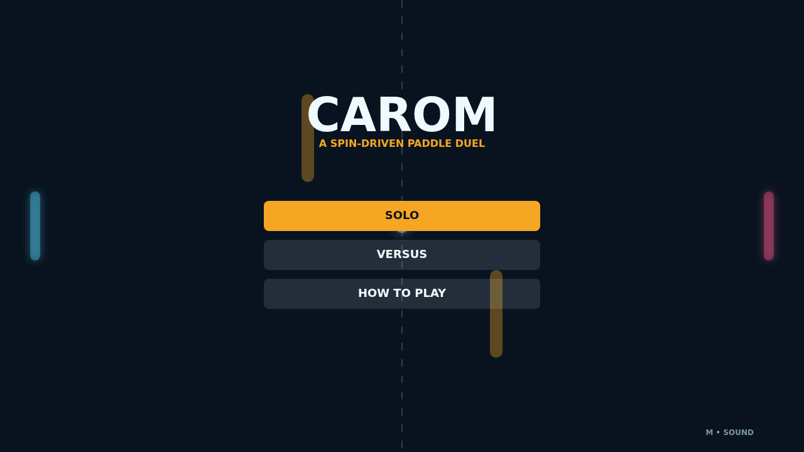

# Carom

Carom turns a clean paddle duel into a compact bank-shot puzzle. Every rally begins at center field, then accelerates between luminous paddles, the walls, and two amber gates waiting to redirect a bold shot.

The decisive move is not just where you meet the ball, but how you are moving when it arrives. Sweep a paddle through contact to pour spin into the flight, then watch the trail arc into a return that would be impossible in ordinary pong.

Solo mode pits you against a reactive defender; Versus hands both sides of the field to friends at one keyboard. Matches stretch past the finish line until someone earns a two-point lead, so a late curve can always turn match point into another rally.

